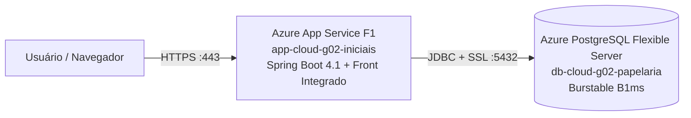

# Carteira de Clientes da Papelaria (Desafio 08)

Sistema de cadastro único de clientes para uma papelaria de bairro, com busca rápida e sem perda de histórico (clientes são **inativados**, nunca excluídos). Este repositório contém o back (API), o front (interface do balcão), o material de QA do grupo e a infraestrutura de nuvem em **Nível A na Azure**.

## Objetivo

Uma papelaria guarda contatos em fichas de papel e no celular do dono. Encontrar um cliente pelo nome é lento e há cadastros duplicados. O sistema resolve isso para o **atendente no balcão**:

| Requisito | O que faz |
|---|---|
| RF1 | Cadastra cliente com código automático (`CLI-0001`), nome, e-mail único, telefone e cidade (dados fictícios) |
| RF2 | Busca por parte do nome (sem diferenciar maiúsculas) e por código exato |
| RF3 | Edita telefone e cidade |
| RF4 | Inativa e reativa cliente; inativos não aparecem na busca padrão |
| RF5 | Paginação de 10 em 10 |
| RF6 | Dados iniciais com 56 clientes fictícios (53 ativos e 3 inativos) |

O objetivo do projeto foi validar esses requisitos pelos critérios de aceitação (CA1 a CA5), testar segurança básica, garantir a persistência dos dados no banco relacional gerenciado e disponibilizar a solução em nuvem no padrão de entrega **Nível A**.

---

## Infraestrutura e Deploy em Nuvem (Nível A — Azure)

- **URL Pública da Aplicação:** `https://app-cloud-g02-iniciais.azurewebsites.net`
- **Health Check da API:** `https://app-cloud-g02-iniciais.azurewebsites.net/health`
- **Grupo de Recursos:** `rg-cloud-g02`
- **Região:** South Africa North

### Arquitetura em Produção

A aplicação foi consolidada em um único artefato Spring Boot (`app.jar`), servindo a API REST e os arquivos estáticos do frontend em HTTPS unificado gerenciado pela Azure:



### Componentes, Banco e Segurança

- **Computação:** Azure App Service (Plano Gratuito **F1**, Linux / Java 21). O deploy foi executado diretamente a partir do artefato compilado `back/target/app.jar`, eliminando etapas de compilação remota para preservar a cota diária de CPU do plano gratuito.
- **Banco de Dados Gerenciado:** Azure Database for PostgreSQL Flexible Server (**Burstable B1ms**, PostgreSQL 16), com a extensão `pg_trgm` habilitada e migrations `V1__criar_tabela.sql` e `V2__seed.sql` validadas e executadas automaticamente pelo Flyway.
- **Segurança de Credenciais e Rede:**
  - Nenhuma credencial ou segredo versionado no repositório (`.gitignore` rígido e arquivo `.env.example` para referência).
  - Conexão JDBC configurada obrigatoriamente com criptografia em trânsito (`sslmode=require`).
  - Firewall do PostgreSQL configurado com a regra de isolamento da nuvem (*Allow public access from any Azure service within Azure to this server*), permitindo que o App Service e o Cloud Shell comuniquem-se diretamente pela rede interna da Microsoft.
- **Variáveis de Ambiente (Configuradas no App Service):**
  - `DATABASE_URL`: String JDBC contendo credenciais e parâmetro `sslmode=require` injetados exclusivamente em tempo de execução.
  - `PORT` e `WEBSITES_PORT`: `8080`.
  - `JAVA_OPTS`: `-XX:+UseSerialGC -Xmx512m` (estabiliza o consumo de heap em 512 MB e utiliza o coletor de lixo Serial GC de thread única, prevenindo falhas de *Out of Memory* e reduzindo o consumo de CPU na camada F1).

### Dificuldades Encontradas e Soluções

1. **Gestão de Memória e Cota no Plano Gratuito F1:**
   - *Problema:* O tier F1 compartilha recursos (1 GB de RAM e 60 min de cota de CPU diária), o que causava instabilidade na inicialização padrão do Spring Boot e risco de estouro de cota em builds remotos.
   - *Solução:* Foi configurada a variável `JAVA_OPTS="-XX:+UseSerialGC -Xmx512m"` para reduzir a carga da JVM e optou-se pelo deploy direto do `.jar` empacotado localmente.
2. **Falha de Gravação de Configurações no Portal Web da Azure:**
   - *Problema:* O formulário de *Environment variables* do portal acusava `Failed to update app settings` de forma assíncrona, descartando alterações na URL de conexão.
   - *Solução:* As variáveis foram aplicadas com precisão atômica via **Azure Cloud Shell** utilizando a Azure CLI (`az webapp config appsettings set`), contornando o erro de validação da interface.
3. **Resolução de Conexão Local em Tethering Móvel (IPv4 vs. IPv6/NAT64):**
   - *Problema:* Durante testes locais fora de redes Wi-Fi convencionais, ferramentas como `Test-NetConnection` conectavam com sucesso ao PostgreSQL via endereço IPv6/NAT64 (`64:ff9b::/96`), enquanto o Java tomava `SocketTimeoutException` por forçar a resolução IPv4 descartada pela operadora móvel.
   - *Solução:* Diagnosticou-se o comportamento ativando logs `DEBUG` do driver PostgreSQL (`org.postgresql`). Para testes locais em rede móvel, utilizou-se `-Djava.net.preferIPv6Addresses=true`; em produção na Azure, a comunicação entre serviços ocorre na rede interna sem essa restrição.

### Gestão de Custos

- O servidor **PostgreSQL Flexible Server** é mantido em estado **Stopped** fora dos períodos de testes e demonstração para economizar horas de computação dos créditos do *Azure for Students*.
- Ao término do ciclo avaliativo, o grupo de recursos `rg-cloud-g02` será desalocado integralmente.

---

## Arquitetura da Aplicação

```
┌────────────┐   HTTP/JSON    ┌───────────────────────┐    JDBC (SSL)    ┌──────────────────────────┐
│ Navegador  │ ─────────────► │ Back: Spring Boot     │ ───────────────► │ PostgreSQL 16            │
│ (front)    │ ◄───────────── │ Java 21, porta 8080   │ ◄─────────────── │ Azure Database for       │
└────────────┘                │ API REST + Flyway     │                  │ PostgreSQL (nuvem)       │
                              │ serve o front em "/"  │                  └──────────────────────────┘
                              └───────────────────────┘
```

- **Front** (`front/`): HTML, CSS e JavaScript puro. Pode ser servido diretamente pelo backend integrado ou rodado de forma isolada via Node.js em `http://localhost:3000`. Os arquivos estáticos oficiais de produção residem em `back/src/main/resources/static/`.
- **Back** (`back/`): API REST em Java 21 + Spring Boot. O schema e os dados de seed são orquestrados pelo Flyway (`V1__criar_tabela.sql` e `V2__seed.sql`).
- **Banco:** PostgreSQL gerenciado na Azure. A numeração dos clientes é gerada por sequence (`CLI-0001`) e a busca textual utiliza o operador `ILIKE` apoiado pela extensão `pg_trgm`.

### Endpoints

| Método | Rota | O que faz |
|---|---|---|
| POST | `/clientes` | Cadastra cliente (201) |
| GET | `/clientes?nome=&incluir_inativos=false&pagina=1` | Busca por parte do nome, 10 por página |
| GET | `/clientes/{codigo}` | Busca por código (404 se não achar) |
| PATCH | `/clientes/{codigo}` | Edita telefone e/ou cidade |
| PATCH | `/clientes/{codigo}/inativar` | Inativa cliente (204) |
| PATCH | `/clientes/{codigo}/reativar` | Reativa cliente (204) |
| GET | `/health` | Estado da API e conectividade com o banco (503 se o banco estiver indisponível) |

A documentação interativa OpenAPI/Swagger está disponível em `/swagger-ui.html`.

---

## Como Executar Localmente

### Pré-requisitos

- **Java 21**
- Docker (caso opte pelo banco local via container)
- Node.js (apenas se desejar executar o servidor de desenvolvimento do frontend separado)

### Executando com Banco Local via Docker

Para rodar a aplicação em ambiente de desenvolvimento sem depender da nuvem:

```bash
cd back
docker compose up -d
./mvnw spring-boot:run          # conecta no postgresql local (localhost:5432)
```

O Flyway criará as tabelas e aplicará a carga inicial de 56 clientes automaticamente na primeira inicialização.

### Executando Localmente Conectado à Nuvem (Azure)

1. Certifique-se de que o servidor PostgreSQL da Azure está no status **Ready** (ligado) e que seu IP público foi autorizado nas regras de firewall do banco.
2. Defina a variável de ambiente no seu terminal (sem versionar no código):
   ```bash
   # Linux / macOS
   read -s DATABASE_URL
   export DATABASE_URL
   ./mvnw spring-boot:run
   ```
   ```powershell
   # Windows PowerShell
   $env:DATABASE_URL="jdbc:postgresql://db-cloud-g02-papelaria.postgres.database.azure.com:5432/postgres?user=admin_papelaria&password=SUA_SENHA&sslmode=require"
   java -jar target/app.jar
   ```

---

## Material de QA e Evidências

| Item | Descrição / Localização |
|---|---|
| **Matriz de Testes** | `matriz_testes_papelaria.xlsx` (mapeamento completo de CA1 a CA5) |
| **Pasta de Evidências** | Diretório `evidencias/` com capturas de tela datadas |
| **E1 — Ambiente Publicado** | Prints da aplicação em produção na Azure (`/health` retornando HTTP 200 e tela principal carregando clientes) |
| **E2 — Prova de Persistência** | Sequência de evidências demonstrando a sobrevivência de dados cadastrados (`G02-PALAVRA`) após reinício forçado (*Restart*) do App Service e conferência direta no banco via Cloud Shell (`psql`) |
| **E5 — Segurança de Configuração**| Print da tela de *Environment variables* no Azure App Service com senhas e segredos devidamente ocultos |

---

## Problemas Conhecidos

- **Busca com Caracteres Curinga:** Os caracteres `%` e `_` no campo de busca são interpretados nativamente pelo operador `ILIKE` do PostgreSQL (ex.: pesquisar por `%` retorna todos os registros da base). Severidade: Baixa.
